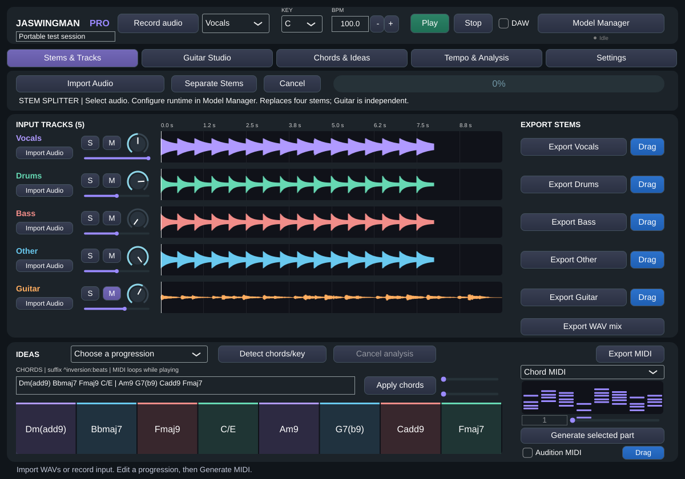

# JASWINGMAN PRO

C++20 / JUCE 8 audio and MIDI workstation plugin under active development. The Linux implementation includes real WAV recording/mixing, spectral harmonic analysis, deterministic bass/drum/melody generation and host-playhead scheduling. **Real HTDemucs CPU inference now passes on a real 20-second stereo music fixture in Linux, including plugin-managed import/export and cancellation. macOS AU validation, Logic/MainStage and M1 performance remain untested. This is not a production-ready release.**

## Implemented and tested on Linux

- Five actual waveform lanes: Vocals, Drums, Bass, Other and independent Guitar; supported audio import, recording, gain, multi-solo, mute, balance, WAV export and background-prepared audio drag files. HTDemucs still separates exactly four sources.
- Cancellable background key/chord/tuning analysis with eight detected chord qualities, confidence margins and timed labels. Synthetic tests: 96/96 held chords and 24/24 cadence keys; no recorded-song accuracy claim.
- Advanced chord parser/editor (extensions, altered dominants, slash bass), seeded cinematic style rules, optional voice leading, timeline zoom/scroll and chord MIDI export.
- Seeded harmony/scale-aware bass, GM drum and constrained melody generators; 4/8/16/32 bars, parameter editors, drum step editing and local phrase variation.
- Guitar Studio: standard-tuning fret-constrained strums/picking, four variations, seeded humanization, background basic stereo plucked-string rendering, 44.1/48kHz PCM24 export. All five guitar types are basic synthesis profiles, not realistic samples.
- Background tempo analysis, heuristic confidence, half/double alternatives, beat markers, Tap Tempo and explicit Apply. No default BPM is shown as a measured result.
- Selected-part audition, 960-PPQ SMF export and held-gesture MIDI/audio file dragging with bounded retention and export fallbacks.
- JUCE host BPM/PPQ/meter/transport/loop reading, sustained-note chase, note ownership, bypass and a fixed preview voice pool. Mock-host validation only.
- Resizable vector GUI and version-2 five-track state that reads legacy version-1 four-track sessions with optional pan/window, generated-note/settings, host-sync and inference-path properties. Audio remains embedded in state.



Actual Linux integration render with test fixtures and synthesized Guitar audio; not a Mac/Logic screenshot or a photograph of isolated guitar.

New documentation: [User guide](Documentation/JASWINGMAN-USER-GUIDE.md), [exact Mac M1 upgrade/build/install commands](Documentation/JASWINGMAN-MAC-M1.md), and [staged validation report](Documentation/JASWINGMAN-V1.md).

Five workspaces preserve the original mixer/MIDI workflow and add Guitar Studio, Chords & Ideas, Tempo & Analysis, and Settings. Cinematic ideas use style rules; only the verified HTDemucs splitter uses a trained model.

## Model support: genuine CPU inference validated on Linux

Model Manager starts an embedded, pinned Python worker off the audio thread. It supports explicit download/license consent, official checkpoint hash verification, offline verification, progress, cancellation and atomic synchronized stem import. There are no bundled weights or silent downloads.

The official host is accessible and the 84,141,911-byte HTDemucs checkpoint is pinned by full SHA-256. Real model execution, synchronized nonempty 24-bit stems, mono/48-kHz conversion, plugin lane export and cancellation during inference pass on Linux. Signal/format/mixture checks are measured; the fixture has quiet vocals/bass and no isolated reference stems, so broad source-quality or SDR claims are not supported. See [inference evidence](Documentation/INFERENCE-VALIDATION.md) and [model setup/license](Models/README.md).

## Build

CMake 3.22+, C++20 compiler and Git. JUCE 8.0.6 is fetched at a pinned commit, or use `-DJUCE_SOURCE_DIR=/path/to/JUCE`. Select the appropriate JUCE licence before distributing binaries.

### macOS Apple Silicon

With Xcode Command Line Tools, CMake and Python 3:

```sh
./Scripts/build-macos.sh
./Scripts/install-macos.sh 'build-macos/Wingman_artefacts/Release/AU/JASWINGMAN PRO.component' --adhoc
./Scripts/validate-au.sh "$HOME/Library/Audio/Plug-Ins/Components/JASWINGMAN PRO.component"
```

The build script defaults to native arm64 Release and macOS 11+. Set `WINGMAN_ARCHS='arm64;x86_64'` for a supported universal toolchain. Formats: AU, VST3, Standalone. Installation is user-level, preserves an existing same-name bundle and optionally ad-hoc signs a local-development copy; it is not notarized packaging.

**AU discovery:** MIDI input means Music Effect (`aumf`), not the old guessed `aufx`. The category is now explicit; bundle ID `com.wingmanaudio.wingman`, subtype `Wgm1` and manufacturer `Wgma` are preserved. Validation reads actual compiled Info.plist identifiers and checks architecture/signing. [Detailed AU troubleshooting](Documentation/AU-VALIDATION.md). Actual `auval`, Logic/MainStage and CoreAudio tests remain unrun.

### Linux

Debian/Ubuntu prerequisites:

```sh
sudo apt-get update
sudo apt-get install -y build-essential cmake ninja-build pkg-config python3 \
  libasound2-dev libx11-dev libxext-dev libxinerama-dev libxrandr-dev \
  libxcursor-dev libfreetype6-dev libfontconfig1-dev libgl1-mesa-dev
./Scripts/build-linux.sh -G Ninja
```

Linux builds VST3 and Standalone. The application is `build/Wingman_artefacts/Debug/Standalone/JASWINGMAN PRO`. A real audio device is needed to validate physical playback/capture. For headless rendering, install `xvfb`/`xauth`; the Linux script uses `xvfb-run` when available and DISPLAY is unset.

Portable JUCE-free DSP/analysis/generation/transport tests:

```sh
cmake -S . -B build-dsp -DWINGMAN_BUILD_PLUGIN=OFF
cmake --build build-dsp --parallel 2
ctest --test-dir build-dsp --output-on-failure
```

Full tests use `ctest --test-dir build --output-on-failure`. `WINGMAN_TRACE_TESTS=1` reports integration check names; `WINGMAN_SCREENSHOT=/absolute/path/ui.png` renders actual components using generated WAV fixtures (never shipped application demo data). Python fixture/worker tests are registered when a Python interpreter is available.

## Documentation

- [Per-phase commits, files, tests and remaining acceptance](Documentation/PHASE-REPORT.md)
- [Exact MacBook Air M1 Terminal/runbook commands](Documentation/MACBOOK-M1-TESTING.md)
- [Current inference evidence](Documentation/INFERENCE-VALIDATION.md)
- [Outstanding GUI/audio-thread/host review](Documentation/OUTSTANDING-REVIEW.md)
- [User manual](Documentation/USER-MANUAL.md)
- [Audit, risks and staged implementation](Documentation/IMPLEMENTATION.md)
- [Harmonic analysis and measured synthetic accuracy](Documentation/HARMONIC-ANALYSIS.md)
- [Generation controls, MIDI mappings and limitations](Documentation/GENERATION.md)
- [Host synchronization and real-time caveats](Documentation/HOST-AND-REALTIME.md)
- [Model setup/licensing](Models/README.md)
- [Performance status](Documentation/PERFORMANCE.md)
- [Development release notes](Documentation/RELEASE-NOTES.md)

## Remaining acceptance work

Vocal-rich and isolated-source quality evaluation beyond the current real fixture; native M1 8-GB CPU/CoreML measurements; actual AU/Logic/MainStage and external MIDI drag/routing tests; annotated recorded-song analysis metrics; meter-aware generation beyond 4/4; complete piano-roll/candidate editing; lock-free session exchange and callback allocation instrumentation; signing/notarization/release packaging. Synchronous import/export/waveform/state operations can still stall the calling/UI thread. See feature documents for scope; do not infer production readiness from Linux compilation.

Optional validator tests require the pinned inference runtime:

```sh
cmake -S . -B build -DWINGMAN_INFERENCE_PYTHON=/absolute/runtime/bin/python
cmake --build build --parallel 2
ctest --test-dir build --output-on-failure
```

To explicitly run genuine inference through the embedded plugin worker (no silent downloads), use an installed verified checkpoint and an 8–120-second real WAV:

```sh
WINGMAN_REAL_MODELS=/absolute/models \
WINGMAN_REAL_PYTHON=/absolute/runtime/bin/python \
WINGMAN_REAL_INPUT=/absolute/owned-test.wav \
ctest --test-dir build -R '^integration$' -V
```

This test completes separation/import/export and then starts another model run to cancel after real chunk processing. Normal tests report when this opt-in block is not requested. See the M1 runbook for clone/update, dependencies, native build, installation, actual-identifier AU validation and real-model commands.

Main-interface Stem Splitter and held-gesture MIDI/stem dragging: see [usage and Logic verification checklist](Documentation/STEM-SPLITTER-AND-MIDI-DRAG.md). Native Logic dragging remains unverified until tested on macOS.

### User-supplied sampled guitar (SFZ subset)

Guitar Studio can now load/verify a user-licensed SFZ instrument on a background
worker and render its generated MIDI through recorded samples. It supports velocity
layers, per-string channel zones, round-robin and release samples. No recordings are
bundled. Basic Synthesis remains explicitly labeled. See
[Sample library format, licensing, limits and Mac checks](Documentation/Samples/README.md).
Preview Audio plays the rendered Guitar lane; Preview MIDI supports live preloaded
sample voices. Streamed sample tails are not implemented. AU loading and Logic file dragging still require native testing.


### Playback and imported-song guitar workflow

Imported audio and generated MIDI now run from immutable playback snapshots without
acquiring the session mutex in the audio callback. DAW sync supports PPQ, seconds
or sample positions and preserves independent BPM. Imports queue tempo/key/chord
analysis with explicit Apply controls; Guitar Studio can generate from the actual,
editable detected chord timestamps, including gaps. The standalone has separate
verified-bundle install and launch tools for macOS.

See [Mac build/install/launch and host verification](Documentation/PLAYBACK-SONG-GUITAR-M1.md)
and [portable regression evidence](Documentation/SESSION-ENGINE-VALIDATION.md).
Native AU/Logic/MainStage and physical M1 tests must be run on the Mac.

Development instrument upgrade: [user-SFZ banks, guitar controls, licensing,
validation and exact Mac commands](Documentation/GUITAR-INSTRUMENT.md).
No production guitar recordings are bundled; verified user libraries enable sampled
playback, while Basic Synthesis remains explicitly labeled.

## Jas PRO Ultimate Loop Studio development

A separate eight-track standalone target is under development, preserving the
existing plugin. See [implementation status and Mac build commands](Documentation/OMNILOOP-IMPLEMENTATION.md).
