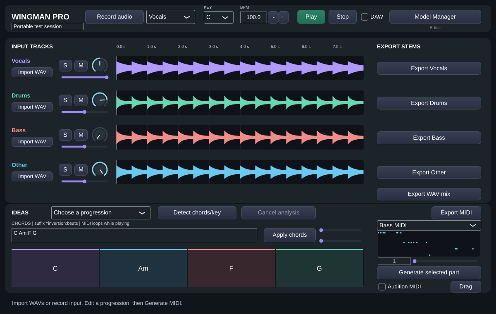

# Wingman Pro

C++20 / JUCE 8 audio and MIDI workstation plugin under active development. The Linux implementation includes real WAV recording/mixing, spectral harmonic analysis, deterministic bass/drum/melody generation and host-playhead scheduling. **Actual HTDemucs inference, macOS AU validation, Logic Pro and M1 performance are not yet verified. This is not a production-ready AI plugin release.**

## Implemented and tested on Linux

- Four actual waveform lanes: Vocals, Drums, Bass, Other; WAV import, input recording, gain, multi-solo, mute and stereo balance.
- Cancellable background key/chord/tuning analysis with eight chord qualities, confidence margins and timed labels. Synthetic tests: 96/96 held chords and 24/24 cadence keys; no recorded-song accuracy claim.
- Clickable chord root/quality/inversion/duration editing, timeline zoom/scroll and chord MIDI export.
- Seeded harmony/scale-aware bass, GM drum and constrained melody generators; 4/8/16/32 bars, parameter editors, drum step editing and local phrase variation.
- Selected-part audition, standard MIDI file export, external MIDI drag request, individual 24-bit WAV stems and audible audio mix export.
- JUCE host BPM/PPQ/meter/transport/loop reading, sustained-note chase, note ownership, bypass and a fixed preview voice pool. Mock-host validation only.
- Resizable vector GUI and compatible version-1 plugin state with optional pan/window, generated-note/settings, host-sync and inference-path properties. Audio remains embedded in state.



Actual Linux integration render using synthesized WAV fixtures. This is not a macOS/Logic screenshot or evidence of AI-separated stems.

## Model support: implemented adapter, unverified inference

Model Manager starts an embedded, pinned Python worker off the audio thread. It supports explicit download/license consent, official checkpoint hash verification, offline verification, progress, cancellation and atomic synchronized stem import. There are no bundled weights or silent downloads.

The Demucs/PyTorch runtime imports successfully on Linux. The official checkpoint host returned HTTP 403 and its allowlist change is not yet applied to this running environment. **No actual trained-model separation run or separation-quality/RAM benchmark has succeeded here.** The worker implementation and failure tests must not be described as tested AI separation. See [model setup and license](Models/README.md).

## Build

CMake 3.22+, C++20 compiler and Git. JUCE 8.0.6 is fetched at a pinned commit, or use `-DJUCE_SOURCE_DIR=/path/to/JUCE`. Select the appropriate JUCE licence before distributing binaries.

### macOS Apple Silicon

With Xcode Command Line Tools, CMake and Python 3:

```sh
./Scripts/build-macos.sh
./Scripts/install-macos.sh 'build-macos/Wingman_artefacts/Release/AU/Wingman Pro.component' --adhoc
./Scripts/validate-au.sh "$HOME/Library/Audio/Plug-Ins/Components/Wingman Pro.component"
```

The build script defaults to native arm64 Release and macOS 11+. Set `WINGMAN_ARCHS='arm64;x86_64'` for a supported universal toolchain. Formats: AU, VST3, Standalone. Installation is user-level, preserves an existing same-name bundle and optionally ad-hoc signs a local-development copy; it is not notarized packaging.

**AU discovery:** MIDI input means Music Effect (`aumf`), not the old guessed `aufx`. The category is now explicit; bundle ID `com.wingmanaudio.wingman`, subtype `Wgm1` and manufacturer `Wgma` are preserved. Validation reads actual compiled Info.plist identifiers and checks architecture/signing. [Detailed AU troubleshooting](Documentation/AU-VALIDATION.md). Actual `auval`, Logic/MainStage and CoreAudio tests remain unrun.

### Linux

Debian/Ubuntu prerequisites:

```sh
sudo apt-get update
sudo apt-get install -y build-essential cmake ninja-build pkg-config python3 \
  libasound2-dev libx11-dev libxext-dev libxinerama-dev libxrandr-dev \
  libxcursor-dev libfreetype6-dev libfontconfig1-dev libgl1-mesa-dev
./Scripts/build-linux.sh -G Ninja
```

Linux builds VST3 and Standalone. The application is `build/Wingman_artefacts/Debug/Standalone/Wingman Pro`. A real audio device is needed to validate physical playback/capture. For headless rendering, install `xvfb`/`xauth`; the Linux script uses `xvfb-run` when available and DISPLAY is unset.

Portable JUCE-free DSP/analysis/generation/transport tests:

```sh
cmake -S . -B build-dsp -DWINGMAN_BUILD_PLUGIN=OFF
cmake --build build-dsp --parallel 2
ctest --test-dir build-dsp --output-on-failure
```

Full tests use `ctest --test-dir build --output-on-failure`. `WINGMAN_TRACE_TESTS=1` reports integration check names; `WINGMAN_SCREENSHOT=/absolute/path/ui.png` renders actual components using generated WAV fixtures (never shipped application demo data). Python fixture/worker tests are registered when a Python interpreter is available.

## Documentation

- [Per-phase commits, files, tests and remaining acceptance](Documentation/PHASE-REPORT.md)
- [User manual](Documentation/USER-MANUAL.md)
- [Audit, risks and staged implementation](Documentation/IMPLEMENTATION.md)
- [Harmonic analysis and measured synthetic accuracy](Documentation/HARMONIC-ANALYSIS.md)
- [Generation controls, MIDI mappings and limitations](Documentation/GENERATION.md)
- [Host synchronization and real-time caveats](Documentation/HOST-AND-REALTIME.md)
- [Model setup/licensing](Models/README.md)
- [Performance status](Documentation/PERFORMANCE.md)
- [Development release notes](Documentation/RELEASE-NOTES.md)

## Remaining acceptance work

Verified trained-model inference and a licensed real-music benchmark; native M1 8-GB CPU/CoreML measurements; actual AU/Logic/MainStage and external MIDI drag/routing tests; annotated recorded-song analysis metrics; meter-aware generation beyond 4/4; complete piano-roll/candidate editing; lock-free session exchange and callback allocation instrumentation; signing/notarization/release packaging. Synchronous import/export/waveform/state operations can still stall the calling/UI thread. See feature documents for scope; do not infer production readiness from Linux compilation.
